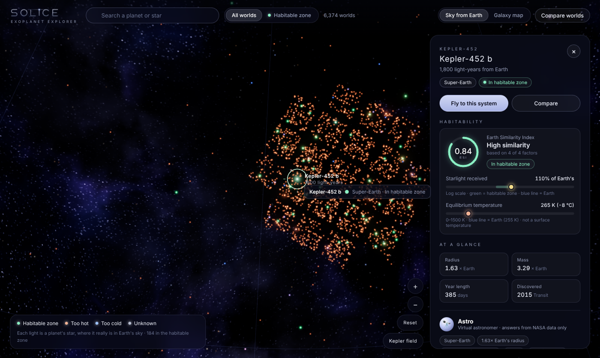
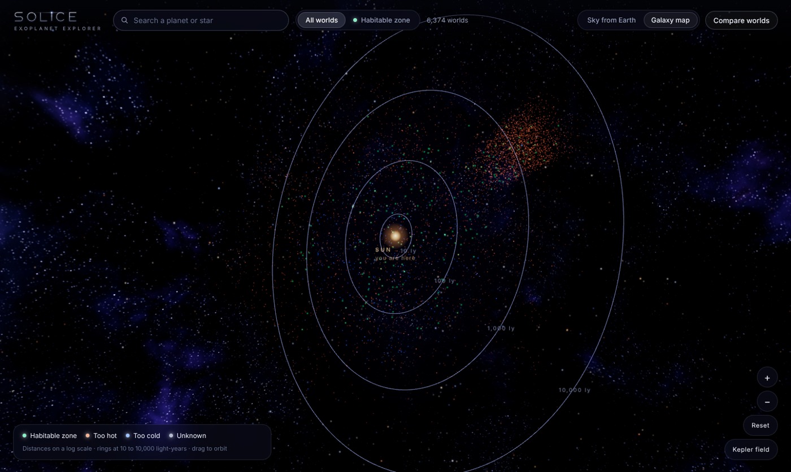
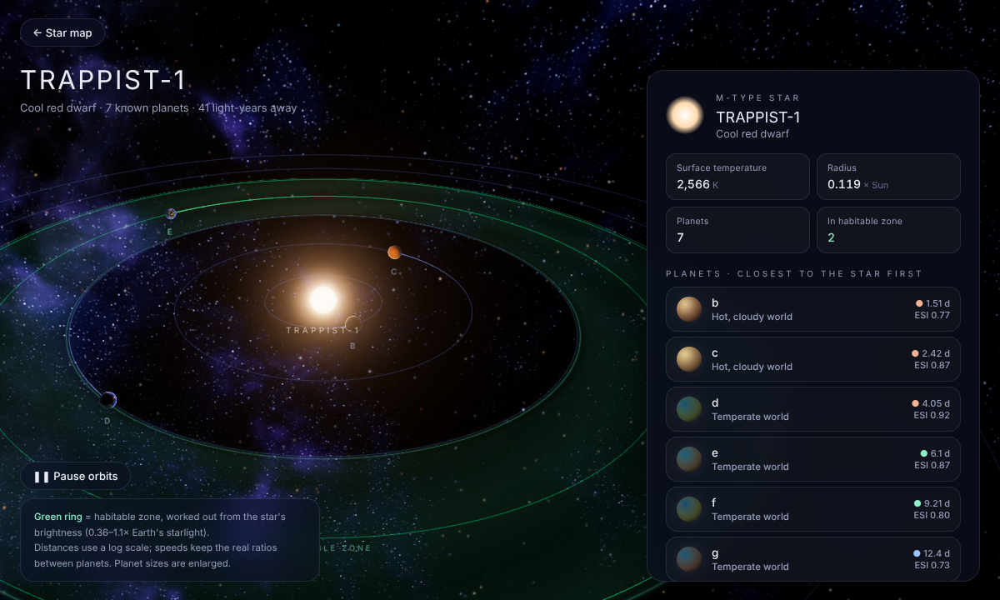
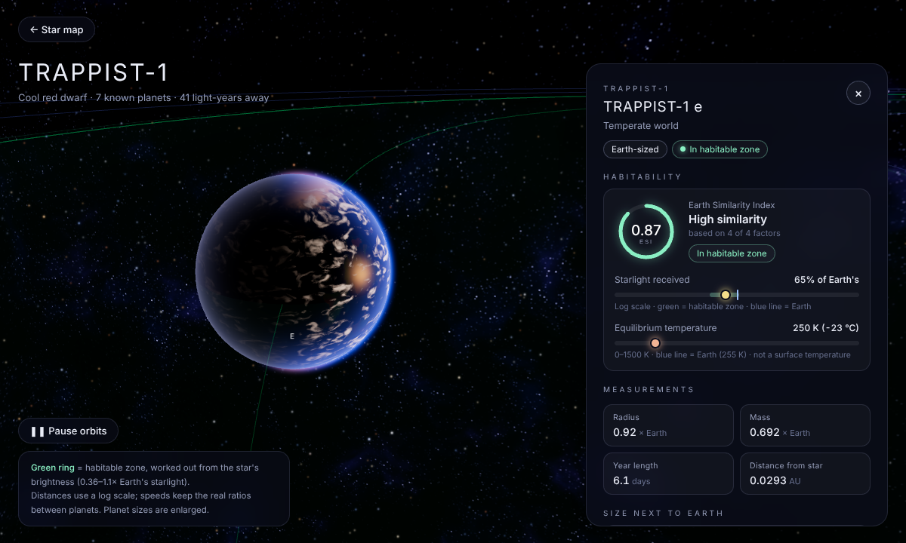
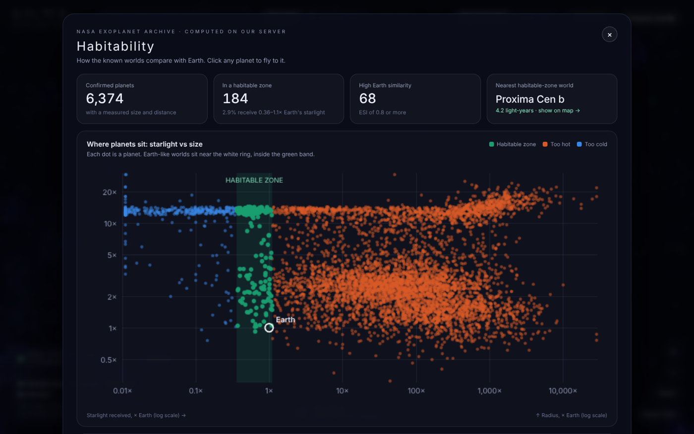
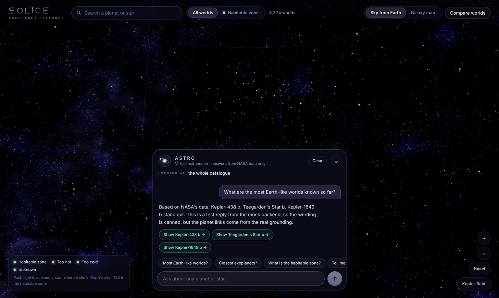
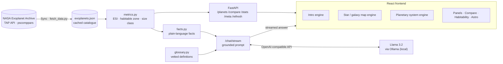

<div align="center">

# SOLICE

### Explore the worlds beyond our Sun

An AI-powered 3D explorer for every confirmed exoplanet, built on live data from NASA's Exoplanet Archive,<br/>
with **Astro**, a virtual astronomer that explains them using only real data.

**[🎥 Watch the demo](https://drive.google.com/file/d/1GizD4khv7UuYTV6QtFAFuciFpTSeOY8f/view?usp=sharing)** ·
**[Hackathon submission](https://github.com/cbitosc/HFT26-TEAM-64/pull/1)**




</div>

---

## Why SOLICE

More than **6,000 planets** have been confirmed around other stars. NASA publishes every one of them, but as a
research table of codes like `pl_rade`, `pl_insol` and `st_teff`. For most people that data is:

- **Hard to picture.** Rows of numbers don't show where a world is, how far away it is, or what its system looks like.
- **Hard to judge.** "Could it be habitable?" needs several values combined, and some are always missing.
- **Easy to get wrong.** General chatbots answer space questions confidently, often with invented numbers.

SOLICE turns that catalogue into a universe you can fly through, and pairs it with an AI guide that never makes
numbers up.

## Features

| | |
| :--- | :--- |
| 🎬 **Cinematic intro** | A real-time WebGL flight from deep space into the Milky Way, a warp to the Orion Arm, past Earth and out to the Solar System. |
| 🌌 **3D star map** | Every host star at its true position in Earth's sky (RA / Dec), coloured by habitable-zone status. Switch to the **Galaxy map** to see real 3D distances. Search, filter and fly to any star. |
| 🪐 **Planetary systems** | Dive into any system: orbits with real period ratios, a **habitable zone computed from the star's brightness**, and planets whose look follows their real size and temperature. |
| 🔭 **Astro, the AI astronomer** | Ask anything. Answers come only from NASA data and a vetted glossary, and every planet Astro mentions becomes a link that flies the 3D view there. |
| 🌍 **Habitability dashboard** | The whole catalogue at a glance: how many worlds sit in a habitable zone, a starlight-vs-size map with Earth marked, and the most Earth-like planets ranked by ESI. |
| ⚖️ **Compare worlds** | Two planets, or a planet and Earth, side by side, with an AI summary. |
| 🔄 **Live NASA sync** | A badge shows how fresh the data is; one click pulls the latest catalogue and reports newly confirmed planets. |

| | |
| :---: | :---: |
|  |  |
| **Galaxy map:** real 3D positions, log distance | **System view:** TRAPPIST-1 and its habitable zone |
|  |  |
| **Planet close-up:** TRAPPIST-1 e | **Habitability dashboard** |



---

## How it works



1. **Fetch.** The backend queries NASA's TAP API for the `pscomppars` table (one best-value row per confirmed planet)
   and caches it, so the app loads instantly and works offline.
2. **Compute.** `metrics.py` derives what NASA doesn't list directly, using published physics only: star luminosity,
   starlight received, orbit size from Kepler's third law, habitable-zone status and ESI. Missing inputs give
   **unknown**, never a guess.
3. **Explain.** `facts.py` turns the numbers into plain-language facts.
4. **Show.** React and three.js render the star map, systems, panels and dashboard from the API.

### The AI never invents numbers

Astro is **retrieval-augmented generation over structured data**. For each question the backend retrieves exactly
what's relevant (the planet or system on screen, planets named in the question, catalogue rankings such as "nearest"
or "most Earth-like", and glossary definitions for "what is…" questions), puts only those facts in the prompt, and
tells the model to answer from them alone or say that NASA's data doesn't cover it.

Retrieval uses **exact lookups instead of a vector database**: with a structured table, similarity search could fetch
the wrong planet's numbers, while an exact lookup can't. Only planets the model was given become clickable links. The
model writes the words; the code computes every number.

### Habitability science

- **Habitable zone:** a planet is *in* the zone if it receives **0.36–1.1×** the starlight Earth gets. In the system
  view the zone is drawn from the star's luminosity, `L = R² (T / 5772 K)⁴`, so it moves with every star.
- **Earth Similarity Index (ESI):** weighted geometric similarity to Earth in radius, density, escape velocity and
  equilibrium temperature (Schulze-Makuch et al., 2011). 1.0 = identical to Earth. When mass is unknown, the published
  2-factor version is used and the app says so.
- Neither metric means life exists. SOLICE always says "potentially habitable".

### The 3D

No pre-made models, images or videos. Everything is generated in real time by code:

- **three.js** builds the shapes: spheres, rings, and a single GPU point cloud for 6,000+ stars.
- **Custom GLSL shaders** paint them: procedural planet surfaces (rocky, ocean, ice, lava, gas-giant bands), boiling
  star surfaces, atmospheres, warp streaks and the Milky Way sky, with bloom for the glow.
- Stars are placed from NASA's RA, Dec and distance (`mapRadius = 6 · log10(1 + ly / 10)`), and camera flights use
  ease-in-out curves.
- Robust on any GPU: textures are baked once in tiles, invalid pixels are cleaned before bloom, quality steps down
  if a GPU outputs black frames, and resolution adapts to the frame rate.

### Tech stack

| Layer | Tools |
| :--- | :--- |
| Frontend | React 19, Vite, three.js (WebGL), custom GLSL shaders, UnrealBloom |
| Backend | Python, FastAPI, Uvicorn, Requests |
| AI | Llama 3.2 via Ollama (local), through the OpenAI-compatible `openai` client, so any compatible model can be swapped in |
| Data | NASA Exoplanet Archive TAP API, `pscomppars` table |

---

## Run it locally

**Requirements:** Python 3.10+, Node.js 20+, and [Ollama](https://ollama.com).

**1. Backend** (terminal 1)

```bash
cd backend
python3 -m venv venv
source venv/bin/activate            # Windows: venv\Scripts\activate
pip install -r requirements.txt
ollama pull llama3.2
uvicorn main:app --reload
```

The API runs at http://127.0.0.1:8000 (interactive docs at `/docs`). The NASA catalogue is already cached; use
**Sync** in the app (or `POST /refresh`) to pull the latest.

**2. Frontend** (terminal 2)

```bash
cd frontend
npm install
npm run dev
```

Open http://localhost:5173.

**Optional: another AI model.** Copy `backend/.env.example` to `backend/.env` and point it at any OpenAI-compatible
endpoint:

```
LLM_BASE_URL=http://localhost:11434/v1
LLM_API_KEY=ollama
LLM_MODEL=llama3.2
```

### Controls

| Action | How |
| :--- | :--- |
| Skip the intro | **Skip intro**, or open `localhost:5173/?nointro` |
| Look around / zoom | Drag; scroll or pinch; **+ / −** |
| Pick a planet | Click a light (green = habitable zone) |
| Visit its system | **Fly to this system**; `Space` pauses orbits; `Esc` goes back |
| Galaxy map | **Galaxy map** toggle in the top bar |
| Ask Astro | Bottom-centre button, or press `/` |
| Compare / overview | **Compare worlds**, **Habitability** |
| Latest NASA data | **Sync** |
| GPU trouble | `?intro=safe` or `?intro=basic` |

## Project structure

```
backend/
  main.py           API: planets, compare, stats, meta, refresh, grounded chat
  metrics.py        ESI, habitable zone, size class (pure calculations)
  facts.py          plain-language facts given to the AI
  glossary.py       vetted definitions for "what is…" questions
  fetch_data.py     one-off download from NASA
  exoplanets.json   cached NASA catalogue
frontend/src/
  App.jsx           layout, data loading, view switching
  Intro.jsx, intro/ cinematic intro (engine + shaders)
  space/            3D engines: star map, galaxy map, planetary systems
  Astro.jsx         virtual astronomer
  Panel.jsx, Gauges.jsx, CompareView.jsx, HabitabilityView.jsx, DataBadge.jsx
  App.css           design system
docs/screenshots/
```

## Honest limitations

- Exoplanet surfaces have never been photographed; planet looks are generated from size and temperature and are labelled as illustrative.
- System and galaxy views use log scales so tight and huge systems both stay readable; exact values are always in the panels.
- Equilibrium temperature is not surface temperature; the UI and Astro both say so.
- Some planets lack the values needed for ESI or habitable-zone status; they show as unknown rather than guessed.
- A small local model keeps the AI free and private, but its phrasing is simpler than a large hosted model's.

## What's next

- A stronger Astro: a larger or hosted model (a one-line `.env` change), voice, and Indian languages
- JWST atmosphere detections and NASA's measurement uncertainties
- Scheduled syncs, a guided learning mode, mobile and WebXR, and a public deployment

## Team lumbar

Built in 24 hours at **CBIT Hacktoberfest '26** (CBIT Hyderabad).

| | |
| :--- | :--- |
| Rhuthvija A | [@Rhuthvija](https://github.com/Rhuthvija) |
| Shraddha | [@shraddha-reddy](https://github.com/shraddha-reddy) |
| Medhashri | [@Medhashri24](https://github.com/Medhashri24) |

## Data & attributions

- This research has made use of the **NASA Exoplanet Archive**, which is operated by the California Institute of
  Technology, under contract with the National Aeronautics and Space Administration under the Exoplanet Exploration
  Program.
- Earth Similarity Index: Schulze-Makuch, D. et al. (2011), *Astrobiology* 11(10).
- Open-source: [three.js](https://threejs.org), [React](https://react.dev), [Vite](https://vitejs.dev),
  [FastAPI](https://fastapi.tiangolo.com), [Ollama](https://ollama.com) (all MIT); Meta Llama 3.2 (Llama 3.2 Community License).
- 3D simplex noise in the shaders: Ashima Arts / Stefan Gustavson (MIT).
- Fonts: Michroma and Inter, from Google Fonts (SIL Open Font License).

## License

MIT. See [LICENSE](LICENSE).
